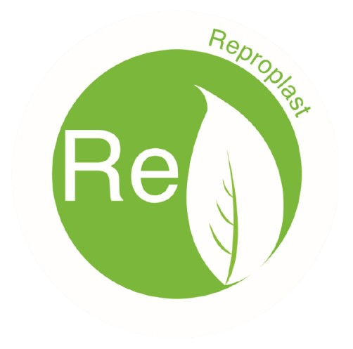
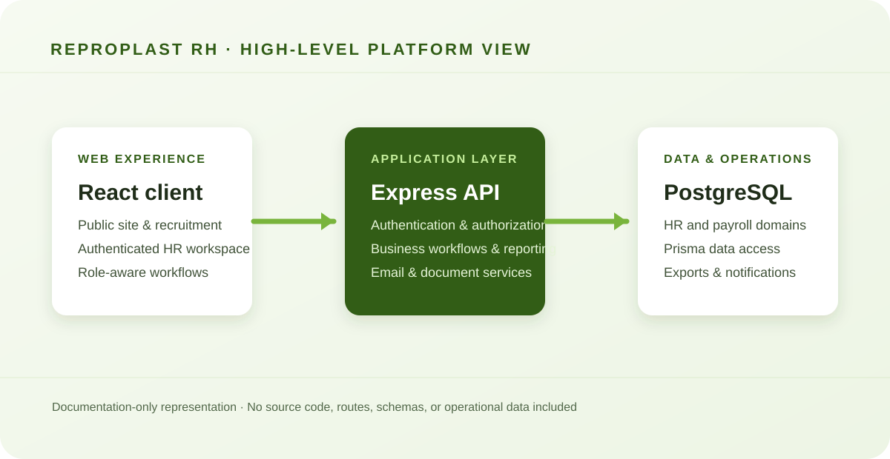

# Reproplast RH — Portfolio Case Study

  

  <strong>A full-stack human-resources platform for a multi-brand recycling group.</strong> 
  Portfolio case study · Source code remains private

---

## Overview

Reproplast RH is an internal platform created for the Reproplast business group. It brings employee operations, recruitment, payroll-related workflows, requests, reporting, and administration into one responsive web experience.

The platform also supports public-facing recruitment and corporate content for the group’s brands: **Reproplast**, **Fabribolsas**, and **SISECO**.

> This repository is a documentation-only portfolio edition, published with permission. It intentionally contains no production source code, operational data, credentials, database exports, internal documents, or employee information.

## Product scope

| Area | Capabilities |
| --- | --- |
| Employee management | Employee records, contracts, documents, salary history, roles, and access control |
| Recruitment | Public job openings, applicant intake, applicant review, and hiring workflows |
| Employee requests | Vacation, overtime, salary advances, and loans |
| Payroll operations | Payroll periods, production-based payroll, settlements, and bank-related workflows |
| Administration | Users, permissions, reference data, companies, departments, and configurable catalogs |
| Reporting | Operational reports for employees, recruitment, requests, benefits, and payroll-related activity |
| Corporate website | Responsive public pages, multi-brand presentation, contact and recruitment entry points |

## My contribution

I contributed across the platform as a **full-stack developer**, collaborating with the Reproplast team on the complete system.

My work included responsive interface improvements, role-based access behavior, employee and applicant workflows, maintenance modules, loans, salary advances, vacations, overtime, payroll-related flows, API integrations, authentication adjustments, backend services, notification emails, and data-handling improvements.

This was collaborative work. Reproplast owns the project, brand, and source code.

## Technical approach

The platform was implemented as a separated web client and API service:

- **Frontend:** React, Vite, Tailwind CSS
- **Backend:** Node.js, Express, TypeScript
- **Data:** PostgreSQL with Prisma
- **Security:** JWT authentication, role and permission controls, protected routes
- **Operations:** file handling, email notifications, PDF and spreadsheet exports

  

## Engineering focus

- Designed responsive, role-aware interfaces for dense administrative workflows.
- Connected modular frontend services to protected backend endpoints.
- Improved employee, recruitment, request, and maintenance experiences as requirements evolved.
- Supported email-based notifications for approvals and recruitment activity.
- Worked with relational data models for HR, payroll, contracts, benefits, and reporting.
- Kept public recruitment journeys separate from authenticated HR operations.

## Screenshot gallery

The gallery is prepared for sanitized product evidence. Screenshots will be added here without publishing the application itself.

| Planned view | What it will demonstrate |
| --- | --- |
| `01-dashboard.webp` | Role-aware HR overview and navigation |
| `02-employee-management.webp` | Employee-management workflow and structured records |
| `03-recruitment.webp` | Job-opening and applicant-review experience |
| `04-requests.webp` | Vacation, overtime, advance, or loan-request workflows |
| `05-payroll.webp` | Payroll-related operations and period management |
| `06-maintenance.webp` | Administrative catalogues, users, roles, and permissions |
| `07-reports.webp` | Operational reporting and export capabilities |

See [`assets/screenshots/README.md`](assets/screenshots/README.md) for the sanitization checklist.

## Privacy and publication boundaries

This is not a runnable application or a copy of the production system. To protect the organization and its people, this portfolio edition excludes:

- Application source code and Git history
- Environment files, credentials, and deployment configuration
- Database schemas, exports, seeds, and operational SQL scripts
- Employee, applicant, payroll, bank, salary, loan, and vacation records
- Uploaded documents, CVs, profile photographs, and internal documentation
- Private API routes and infrastructure details

## Ownership and attribution

**Project owner:** Reproplast

Reproplast RH was developed collaboratively. This case study is published solely to document professional experience and technical contribution, with permission from Reproplast. It is not the official production repository, and it does not grant permission to reuse, copy, deploy, or redistribute the underlying system.

See [NOTICE.md](NOTICE.md) for the complete notice.
